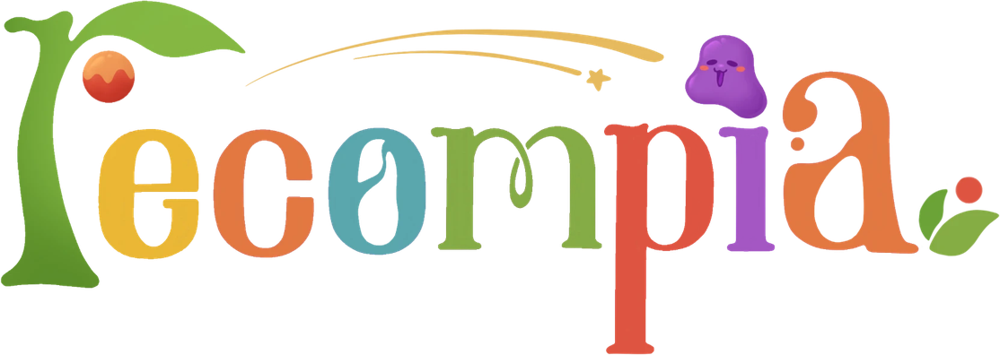
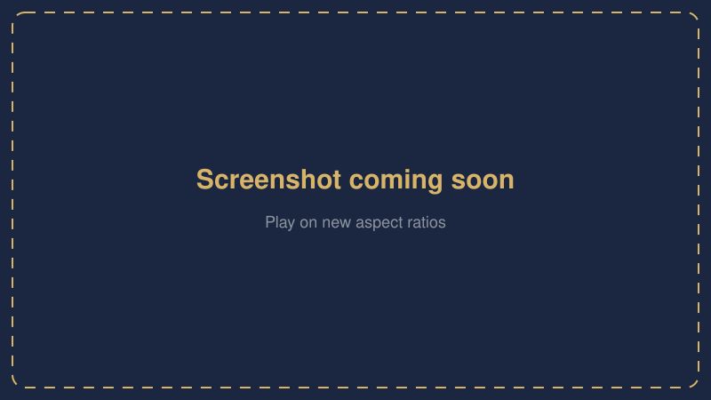

<!-- source-sha256: c634f3c7ee8ae03825b35d79f4ee7e47a222a83971d3505d3bebb09e0b52218d -->

<div dir="rtl">

> هذه ترجمة آلية لملف README الإنجليزي (../../README.md). قد تحتوي على أخطاء، والنسخة الإنجليزية هي المرجع.

<h1 align="center">
  
</h1>

<h3 align="center">Pokopia Recomp</h3>

<p align="center">
  <b>بوكيمون بوكوبيا (Switch 2) معاد تجميعه ليعمل مباشرة على Windows، مع دعم اللعب الجماعي.</b>
</p>

<p align="center">
  <a href="https://github.com/featureJosh/pokopia-recomp/releases/latest"></a>
  <a href="https://github.com/featureJosh/pokopia-recomp/releases/latest"></a>
  <a href="https://github.com/featureJosh/pokopia-recomp/releases">
  
  </a>
  <a href="https://github.com/featureJosh/pokopia-recomp/releases"></a>
  
  
  <a href="https://github.com/featureJosh/pokopia-recomp/commits/main"></a>
  <a href="https://github.com/featureJosh/pokopia-recomp/commits/testing"></a>
  <a href="https://github.com/featureJosh/pokopia-recomp/issues"></a>
</p>

<p align="center">
  <a href="https://github.com/featureJosh/pokopia-recomp/releases/latest"></a>
  <a href="https://github.com/featureJosh/pokopia-recomp/releases/latest"></a>
</p>

<p align="center">
  <b><a href="https://github.com/featureJosh/pokopia-recomp/releases">الإصدارات</a></b> ·
  <a href="../../CHANGELOG.md">سجل التغييرات</a> ·
  <a href="../../CONTRIBUTING.md">المساهمة</a> ·
  <a href="../../CREDITS.md">شكر وتقدير</a> ·
  <a href="https://github.com/xFractals/pokopia-native">الأصل: pokopia-native</a> ·
  <a href="../../SECURITY.md">الأمان</a> ·
  <a href="../../LEGAL.md">الشؤون القانونية</a> ·
  <a href="https://github.com/featureJosh/pokopia-recomp/issues">المشكلات</a> ·
  <a href="https://discord.recompia.com">Discord</a>
</p>

> [!IMPORTANT]
> **لا تتضمن أي ملفات من اللعبة.** تحتاج إلى نسخة مستخرجة من اللعبة من عندك، الإصدار **2.0.1a**. لا يوفر هذا المشروع أي ملفات لعبة أو مفاتيح أو أدوات استخراج. لا صلة له بشركة Nintendo أو The Pokémon Company أو Koei Tecmo؛ Pokémon علامة تجارية لشركة Nintendo وCreatures Inc. وGAME FREAK inc. (انظر [LEGAL.md](../../LEGAL.md)).

> [!NOTE]
> **مبني بالذكاء الاصطناعي، بإشراف إنسان.** يُطوَّر هذا المشروع أساساً بالذكاء الاصطناعي، وأنا المشرف. لديّ بضع سنوات من الخبرة في التطوير، لذا ليس كله عملاً رديئاً. أُراجع كل تعديل (commit) وأتحقق منه وأختبره بنفسي قبل دمجه.

## لقطات الشاشة

<table>
  <tr>
    <td width="50%"><br><sub>شاشة العنوان</sub></td>
    <td width="50%"><br><sub>بناء جزيرتك</sub></td>
  </tr>
  <tr>
    <td width="50%"><br><sub>العب بنسب عرض إلى ارتفاع جديدة</sub></td>
    <td width="50%"><br><sub>Link Play مع صديق</sub></td>
  </tr>
</table>

## الميزات

### العب معاً (Link Play)
- **قُم بزيارة جزيرة صديق، أو ادعُه إلى جزيرتك**، على شبكة Wi-Fi نفسها أو عبر الإنترنت.
- **اللعب المشترك مع لاعبي [pokopia-native](https://github.com/xFractals/pokopia-native)** على إصدار اللعبة 2.0.1.
- اضبطه من صفحة **Link Play** في المشغّل. لا ملفات تحتاج إلى تعديل.
- دليل خطوة بخطوة: [اللعب معاً](#playing-together).

### استيراد ملفات الحفظ
- **هل تلعب بالفعل على Eden أو Ryujinx؟** زر واحد في **Settings** يعثر على ملف حفظك وينقله. نسخة المحاكي الخاصة بك لا تُمس.
- **هل لديك ملف حفظ في مكان آخر؟** اختر مجلده (المجلد الذي يحتوي على `B00` و`G00` و`S00` في داخله).
- **ملف حفظك الحالي لا يُحذف أبداً.** يُحفظ أولاً كمجلد نسخة احتياطية.
- إذا تعذّرت كتابة ملف حفظ (قرص ممتلئ، أو OneDrive أو برنامج مكافحة فيروسات يحتفظ بالملف)، يُحتفظ بآخر ملف حفظ سليم وتخبرك اللعبة بذلك.

### إعداد سهل
- **استخدم نسختك المستخرجة كما هي:** مجلد (يحتوي على `base` و`updates`) أو ملف `.nup` واحد.
- **رسائل واضحة إذا كان هناك خطأ في نسختك:** إصدار اللعبة الخطأ، أو تحديث مفقود، أو ملفات تالفة أثناء النسخ. يخبرك المشغّل بما يجب فعله.
- **فحوصات قبل البدء:** مساحة قرص كافية، وتعريف رسومات يعمل، وذاكرة كافية.
- **Use fewer cores** يبقي حاسوبك قابلاً للاستخدام أثناء البناء. يمكنك الإيقاف المؤقت والمتابعة لاحقاً.
- **التحديثات سريعة:** تُعاد فقط الأجزاء التي تغيّرت.
- يخبرك المشغّل عند صدور إصدار جديد.

### أدوات التحكم
- **أي ذراع تحكم:** Xbox وPlayStation وSwitch Pro وغيرها، مع اهتزاز وحركة. تتبع الأزرار تخطيط Switch افتراضياً.
- **لوحة المفاتيح والفأرة.** تعمل الفأرة أيضاً في القوائم: انقر لتأكيد العنصر المحدد؛ ومرّر أو استخدم مفاتيح الأسهم لتحريك التحديد.
- **غيّر أي زر** في صفحة **Controls** عبر F1.
- **وضع الفأرة Joy-Con 2** لوضع العناصر: اضغط زر الفأرة الأوسط.
- **أيقونات الأزرار على الشاشة تطابق ما تحمله:** لوحة مفاتيح، أو Xbox، أو PlayStation، أو Switch.
- **كتابة اسمك** تعمل بذراع التحكم أو الفأرة أو لوحة المفاتيح.
- **الخروج دون Alt+F4:** اضغط باستمرار Select وStart (View وMenu على ذراع Xbox)، أو استخدم **Quit game** في F1.
- **افتح قائمة F1 من ذراع التحكم:** اضغط على العصاتين معاً (L3 + R3)؛ غيّره أو عطّله عبر `[overlay] pad` في `controls.ini` (`none` = معطّل). لا يمكن أن يكون مزيج الخروج.

### Steam Deck والأجهزة المحمولة
- يتم التعرف على Steam Deck وLegion Go S والأجهزة المحمولة الأخرى: تبقى أيقونات ذراع التحكم على الشاشة ويناسب حجم الصورة الشاشة.
- تُملأ شاشات 16:10 حتى الحواف، دون أشرطة سوداء.
- يعمل عبر Proton على SteamOS، مع تسريعات للأجهزة المحمولة (نحو 26 إلى 53 إطاراً في الثانية على Steam Deck و55 إلى 75 إطاراً في الثانية على Legion Go S، حسب قياسات اللاعبين).
- يعمل المشغّل على Linux وSteamOS أيضاً: انظر [Linux وSteamOS وSteam Deck](#linux-steamos-and-the-steam-deck).

### الرسومات
- **العب بأي دقة**، 4K وما فوق. خفّض **Render scale** إذا كان التشغيل بطيئاً.
- **الإعدادات المسبقة للجودة** (Switch 2 وHigh وUltra) تحدد مدى الرؤية وحدّة الملمس.
- **HDR** على شاشات HDR.
- **نافذة أو بلا حدود أو ملء الشاشة.** اختر الشاشة، وحدد معدل الإطارات، وأظهر عداد الإطارات. Alt+Enter يبدّل الأوضاع أثناء اللعب.
- **الموسعات:** FSR 1 وNVIDIA Image Scaling يعملان.
- **FSR 3 وDLSS / DLAA موجودان لكن مظهرهما ليس جيداً بعد** ويحتاجان إلى إعادة عمل. اتركهما معطّلين الآن.

### إعدادات داخل اللعبة
اضغط **F1** في اللعبة لتغيير الرسومات والتحكم والصوت (مستوى الصوت، وجهاز الإخراج، وكتم الصوت عندما تكون النافذة في الخلفية). تُطبّق معظم التغييرات فوراً.

## البدء السريع

1. نزّل ملف zip من [أحدث إصدار](https://github.com/featureJosh/pokopia-recomp/releases/latest) واستخرجه في أي مكان.
2. شغّل `PokopiaLauncher.exe`. إذا حذّر SmartScreen، اختر **More info → Run anyway**. اختر مجلد نسختك المستخرجة واضغط **Set up**: يجمّع اللعبة على حاسوبك (نحو 7 دقائق)، ثم يبني ذاكرة الشيدرات المؤقتة (ساعة إلى ساعتين، ويمكنك الإيقاف المؤقت والمتابعة لاحقاً).
3. اضغط **Play**.

F1 يفتح الإعدادات في اللعبة. زر الفأرة الأوسط يبدّل وضع الفأرة Joy-Con 2 لوضع العناصر.

### Linux وSteamOS وSteam Deck

1. في Steam، ثبّت **Proton Experimental** (المكتبة، الأدوات؛ على Steam Deck بدّل إلى وضع سطح المكتب أولاً).
2. نزّل `PokopiaRecomp-<version>-linux-x64.tar.gz` من [أحدث إصدار](https://github.com/featureJosh/pokopia-recomp/releases/latest) واستخرجه في أي مكان (مثلاً مجلد المنزل).
3. شغّل `PokopiaLauncher.AppImage` في ذلك المجلد (انقر عليه نقراً مزدوجاً، أو `./PokopiaLauncher.AppImage` في طرفية). اختر مجلد نسختك واضغط **Set up**: في المرة الأولى ينزّل أدوات البناء (Python وZig، نحو 100 ميغابايت)، ويجمّع اللعبة، ثم يبني ذاكرة الشيدرات عبر Proton. يمكنك الإيقاف المؤقت والمتابعة لاحقاً.
4. اضغط **Play**. اللعبة نفسها تعمل عبر Proton من Steam.

إذا لم يبدأ `PokopiaLauncher.AppImage` على نظام بدون FUSE، شغّل `./PokopiaLauncher.AppImage --appimage-extract-and-run`.

لتشغيل اللعبة من Steam (وضع الألعاب على Deck): في وضع سطح المكتب، اختر **Add a Non-Steam Game**، واختر `PokopiaLauncher.AppImage`، واضبط خيارات التشغيل على `--play`. مزيد من التفاصيل، وما تم اختباره، في [launcher/README.md](../../launcher/README.md#linux-steamos-the-steam-deck-bazzite-other-distributions).

## المودات والترجمات

يمكنك وضع مجلد من الملفات البديلة (مود نصي أو للملمس، أو ترجمة) فوق اللعبة دون لمس نسخة اللعبة المستخرجة: **Settings > Game > Mods**، أو `romfs_mod` تحت `[fs]` في `pkp.ini`. لا شيء مضمّن مع هذا المشروع؛ احصل على المود من مؤلفه.

يجب أن يبدو المجلد الذي تختاره مثل مجلد `romfs` الخاص باللعبة: الملفات والمجلدات نفسها، بدءاً من المستوى الأعلى. ملفاته تستبدل ملفات اللعبة ذات المسار نفسه، وتُدمج المجلدات، وتُقدَّم أيضاً الملفات الموجودة في المود فقط.

```text
MyMod/                       <- choose this folder in Settings > Game > Mods
├── LD_C0_R.BIN              <- same path as in the game's romfs
├── LI_C0_R.IDX
└── motor_asset_re/
    └── ...
```

إذا كان التنزيل يحتوي على مجلد خارجي (مثلاً `2.0.1/romfs/...`)، فاختر مجلد `romfs` الداخلي، الذي يحتوي على `LD_C0_R.BIN`، وليس المجلد الخارجي. إذا كان مستوى المجلد خاطئاً، يقول `pkp.log` إن أياً من ملفات المود لا يستبدل ملفاً من ملفات اللعبة. المودات التي تستبدل ملفات تحتوي على شيدرات غير مدعومة.

### المودات والترجمات (البرتغالية البرازيلية)

يمكنك وضع مجلد من الملفات البديلة (مود نصي أو للملمس، أو ترجمة) فوق اللعبة دون لمس نسختها المستخرجة: **Settings > Game > Mods**، أو `romfs_mod` تحت `[fs]` في `pkp.ini`. هذا المشروع لا يتضمن أي مود؛ اطلبه من مؤلف المود.

يجب أن يكون للمجلد الذي تختاره البنية نفسها لمجلد `romfs` في اللعبة: الملفات والمجلدات نفسها، بدءاً من المستوى الأعلى. ملفاته تحل محل ملفات اللعبة ذات المسار نفسه، وتُدمج المجلدات، وتُستخدم أيضاً الملفات التي توجد في المود فقط.

إذا كان التنزيل يحتوي على مجلد خارجي (مثلاً `2.0.1/romfs/...`)، فاختر مجلد `romfs` الداخلي، الذي يحتوي على `LD_C0_R.BIN`، وليس المجلد الخارجي. إذا كان مستوى المجلد خاطئاً، يحذّر `pkp.log` بأن أياً من ملفات المود لا يستبدل ملفاً من اللعبة. المودات التي تستبدل ملفات تحتوي على شيدرات غير مدعومة.

## التحديث من إصدار أقدم

ملفات الحفظ والإعدادات والشيدرات تبقى.

**من 0.7.5 فما بعد:** اضغط **Update** في الصفحة الرئيسية (أو في Settings > About). ينزّل المشغّل الإصدار الجديد، ويتحقق منه، ويستبدل ملفاته، ويعيد التشغيل.

**من 0.7.0 أو أقدم:** نزّل ملف zip الجديد (Windows) أو `PokopiaRecomp-<version>-linux-x64.tar.gz` (Linux) من [أحدث إصدار](https://github.com/featureJosh/pokopia-recomp/releases/latest)، وأغلق اللعبة والمشغّل، واستخرجه فوق تثبيتك في المجلد نفسه. لا يحتوي على ملفات حفظ أو إعدادات أو ذاكرة شيدرات أو ملفات لعبة، لذا لا يُستبدل أي شيء من ملفاتك.

**إذا أظهرت الصفحة الرئيسية Finish update بعد تحديث:** غيّر ذلك الإصدار شيفرة اللعبة، لذا يبني المشغّل برنامج اللعبة (`pkp.exe`) مرة أخرى من ملفات لعبتك. يحدث ذلك أيضاً إذا تخطيت إصداراً كهذا سابقاً وحدّثت لاحقاً. هذا انتظار قصير، نحو 7 دقائق على معظم الحواسيب وأطول قليلاً على الأجهزة المحمولة، لأن شيدراتك وملفات حفظك محفوظة. ليس الإعداد الأول الطويل: لا تُترجم الشيدرات مرة أخرى إلا إذا ذكرت ملاحظات الإصدار ذلك، وحينها فقط التي تغيّرت. يبقى `pkp.exe` القديم حتى يصبح الجديد جاهزاً.

انسخ مجلد `save` إلى مكان آخر أولاً إذا أردت نسخة احتياطية. ملف حفظ كتبه إصدار أحدث قد لا يُحمَّل في إصدار أقدم.

## اللعب معاً

Link Play يضع عدة لاعبين على جزيرة واحدة. يعمل اللعب المشترك مع لاعبي pokopia-native على إصدار اللعبة **2.0.1**. لا يمكن للاعبين على إصدار 1.0.5 الانضمام.

**ما الذي تغيّر.** يتحدث Link Play الآن بروتوكول اللعب التعاوني الخاص بـ pokopia-native. لا يعمل مع إصدارات Link Play الأقدم من هذه المنقولة، لذا ليحدّث الجميع إلى هذا الإصدار. (يحتفظ المشغّل بالبروتوكول القديم تحت **Advanced**، لجلسة لا يزال فيها الجميع على إصدار قديم.)

**كل لاعب يحتاج ملف حفظ خاصاً به.** نسخة من ملف حفظ شخص آخر لا يمكنها الانضمام إلى أصله.

**اضبطه.** في المشغّل، افتح **Link Play** واختر واحداً:

| الاختيار | استخدمه لـ |
|---|---|
| بمفردي | بدون Link Play. |
| تلقائي (LAN) | الافتراضي. شبكة Wi-Fi أو شبكة واحدة: يُعثر على المضيف تلقائياً. |
| الزيارة بالعنوان | الانضمام إلى مضيف واحد عبر عنوانه، مثلاً `192.0.2.10`. تعرضه صفحة Link Play الخاصة بالمضيف. |
| الإنترنت | اللعب عبر مرحّل (relay) مع رمز غرفة. |

تُطبَّق التغييرات في المرة التالية التي تبدأ فيها اللعبة.

**في اللعبة**، افتح الحاسوب في منزلك الأول، ثم **Link Play** (يُفتح بعد مستوى البيئة 2 في Withered Wasteland) واختر **Local connection**. (**Online connection** خدمة Nintendo الخاصة ولا تعمل هنا.) يختار المضيف **Invite Others to Visit**، ويختار الآخرون **Visit a Friend**.

**الشبكة نفسها.** يختار الجميع **Automatic (LAN)**. تعثر أجهزة Steam Deck وغيرها من أجهزة Proton أو Linux على المضيفين ويُعثر عليها أيضاً، على أي شبكة كانت. إذا لم يظهر المضيف، يختار الزائر **Visit by address** ويكتب عنوان المضيف في الشبكة المحلية. غالباً ما تفصل شبكات المقاهي والفنادق وشبكات Wi-Fi للزوار بين الأجهزة: هناك، العب عبر الإنترنت بدلاً من ذلك.

**عبر الإنترنت.** يختار الجميع **Internet** ويمرون عبر مرحّل:
- يختار المضيف **I host**. تعرض الصفحة رمز غرفة. أعطِ الزوار عنوان المرحّل والرمز. **Copy** و**New code** موجودان في الصفحة.
- يختار الزائر **I visit** ويكتب عنوان المرحّل والرمز.
- لتشغيل مرحّل بنفسك، اضغط **Run a relay here** في صفحة Link Play الخاصة بالمضيف (يعمل ما دام المشغّل مفتوحاً)، أو شغّل `PokopiaLauncher --host` على خادم. أي مرحّل لعب تعاوني من pokopia-native يعمل أيضاً.
- بدون مرحّل، اترك عنوان المرحّل فارغاً عند المضيف ومرّر TCP وUDP على المنفذ **47600** في الموجّه. يستخدم الزوار **Visit by address** مع العنوان العام للمضيف.
- يتحقق المرحّل من رمز الغرفة لكنه لا يشفّر حركة اللعبة.

**المنافذ والجدار الناري.** في أول مرة تستضيف فيها، يسأل Windows Firewall عن `pkp.exe`: اسمح بـ **Private networks**. يجب أن تكون شبكتك Private أيضاً (Settings، Network & internet، اتصالك، Network profile type: **Private**).

| المنفذ | من | البروتوكول |
|---|---|---|
| 47600 | المضيف | TCP وUDP |
| 47610 | المرحّل | TCP، وUDP للمسار الأسرع |

**Interact everywhere وStory co-op (تجريبي، معطّل افتراضياً).** في مناطق القصة تضع اللعبة الزوار في وضع المشاهد. **Interact everywhere** يتيح لهم استخدام الحركات والعناصر، والالتقاط، والوضع، والبناء هناك. **Story co-op** يتيح لهم التحدث إلى شخصيات القصة، ويشغّل Interact everywhere. كل لاعب يحتاج المفتاحين نفسيهما، وإلا لا يُدرج المضيف. ملف حفظ المضيف وحده يحتفظ بتقدم القصة.

لا يزال Link Play قيد الاختبار: الانضمام والتجول معاً يعملان. الجلسات الطويلة، وأكثر من لاعبين، واللعب عبر الإنترنت لم تُختبر بعد. انظر [docs/multiplayer](../multiplayer/README.md) لمعرفة كيف يعمل ومفاتيح `pkp.ini`.

## المشكلات الشائعة

- **النافذة سوداء، أو تتلعثم اللعبة كثيراً، في التشغيل الأول.** تصنع اللعبة بعض الشيدرات أثناء عملها. يترجم المشغّل التي رآها من قبل قبل كل بدء ومرة أخرى بعد خروجك، لذا تكون التشغيلات الأولى خشنة واللاحقة أفضل. امنحها دقيقة وواصل اللعب. إذا توقف الإعداد في منتصفه، افتح **Game files** واضغط **Set up** للمتابعة. يحتفظ بالعمل المكتمل.
- **يقول المشغّل إن ملفات اللعبة من إصدار أقدم، أو إن التحديث مفقود.** يحتاج هذا الإصدار إلى الإصدار 2.0.1a. استخرج اللعبة مرة أخرى مع تثبيت التحديث. اللعبة الأساسية وحدها لا تكفي.
- **يقول المشغّل إنه لم يجد ملفات لعبة صالحة، أو يقول Set up إن ملفاً لا يطابق.** اختر المجلد الذي يحتوي على `base` و`updates` (مثلاً `Pokopia_v2.0.1a`). يحتاج كل منهما إلى `exefs` (`main` و`sdk` و`subsdk0` و`rtld` و`main.npdm`) و`romfs`. الملف الذي لا يطابق تالف. استخرجه مرة أخرى، أو انسخه مرة أخرى.
- **يقول المشغّل إن بيانات اللعبة (romfs) غير مكتملة، أو تُغلق اللعبة عند البدء بـ "pkp.exe exited with code 4".** كتبت أداة الاستخراج `romfs` الخاص بالتحديث دون ملفات اللعبة الأساسية تحته (التحديث يحتوي فقط على الملفات التي يغيّرها). أبقِ اللعبة الأساسية في النسخة نفسها (`base` بجوار `updates`، ولكل منهما `exefs` و`romfs`) واختر المجلد الذي يحتوي على كليهما: يضيف المشغّل الملفات المفقودة من `base` بنفسه. ثم اضغط **Set up** مرة أخرى. وإلا استخرج اللعبة مرة أخرى مع دمج التحديث في اللعبة الأساسية.
- **يقول المشغّل إن النسخة نُسخت في وضع النص.** نسختها باستخدام FTP في وضع النص، مما يتلف `main` و`sdk` و`subsdk0`. انسخ مجلدي `exefs` و`romfs` مرة أخرى مع ضبط نوع النقل على **Binary** (FileZilla: Transfer، Transfer type، Binary).
- **نسختك ملف واحد** (`.nsp`، `.xci`). يأخذ المشغّل اللعبة كمجلدات، أو كملف `.nup`. استخرج `.nsp` أو `.xci` إلى مجلدات بأداة الاستخراج.
- **يتوقف الإعداد بخطأ حول ملف لا يمكن فتحه أو إزالته.** ضع المجلد في مكان بسيط، مثل `C:\Pokopia`، وليس في مجلد يزامنه OneDrive. قد يفحص برنامج مكافحة الفيروسات الملفات التي يبنيها: انتظره، أو اسمح للمجلد. **Open setup log** يظهر أين توقف.
- **يحذّر Set up قبل أن يبدأ.** يفحص مساحة القرص الحرة (نحو 14 غيغابايت مع ملفات الشيدر المحزومة، وهو الإعداد الافتراضي، أو نحو 31 غيغابايت مع الملفات المنفصلة)، وVulkan، والذاكرة، والمعالج أولاً. على معالج سطح مكتب Intel من الجيل 13 أو 14، حدّث BIOS قبل الإعداد: بدون إصلاح Intel يمكن أن تتعطل هذه المعالجات تحت حمل كامل طويل. إذا سخن الحاسوب أو صار صعب الاستخدام أثناء البناء، فعّل **Use fewer cores**.
- **معدل إطارات منخفض، أو صورة ضبابية.** يُثبَّت حجم الصورة عند بدء اللعبة. إنه حجم النافذة أو الشاشة في تلك اللحظة (**Settings**، **Display**).
  - ابدأ في **Borderless** على شاشة 4K وترسم اللعبة بدقة 4K. هذا ثقيل. خفّض **Render scale**.
  - ابدأ **Windowed** (1280x720 افتراضياً) واضغط Alt+Enter، وتبقى الصورة بدقة 720p مكبَّرة. اضبط **Window mode** قبل أن تضغط **Play**.
  - اضبط **Frame rate limit** على ما تستطيع شاشتك عرضه.
- **Link Play: الزائر لا يجد المضيف.** اختر **Visit by address** واكتب عنوان المضيف (تعرضه صفحة Link Play الخاصة بالمضيف). تحقق من أن المضيف بدأ اللعبة واختار **Invite Others to Visit**، وأن Windows Firewall يسمح لـ `pkp.exe` على شبكات Private، وأن الشبكة Private. شبكات المقاهي والفنادق وشبكات Wi-Fi للزوار التي تفصل الأجهزة تحجب لعب LAN للجميع: استخدم **Internet** مع مرحّل ورمز غرفة. عبر الإنترنت، تحقق من عنوان المرحّل ورمز الغرفة. تُطبَّق التغييرات في صفحة Link Play في المرة التالية التي تبدأ فيها اللعبة.
- **Link Play: الاتصال مرفوض.** اللاعبون غير متطابقين. يحتاج الجميع إلى اللعبة 2.0.1، والإصدار نفسه (أو pokopia-native للعب المشترك)، والمودات نفسها ومفتاحي **Interact everywhere** و**Story co-op** نفسيهما.
- **Link Play: "Communication error" (9005) عند الزيارة.** كلاكما يلعب نسخاً من ملف الحفظ نفسه، لذا لكما معرّف اللاعب نفسه. كل لاعب يحتاج ملف حفظ خاصاً به.
- **لا يُكتشف ذراع التحكم.** افتح قائمة F1 في اللعبة وانظر إلى سطر **Gamepad** في صفحة Controls. يقول "No gamepad open" عندما لا ترى اللعبة أي ذراع. وصّله قبل أن تضغط **Play**، ثم جرّب الكابل أو المنفذ الآخر. أغلق البرامج الأخرى التي قد تحتفظ بذراع التحكم.

إذا لم يكن أي من هذه، انظر [الإبلاغ عن المشكلات](#reporting-problems).

## أين ملفات الحفظ والسجلات والإعدادات

كل هذه في مجلد اللعبة: المجلد الذي يحتوي على `PokopiaLauncher.exe` و`pkp.exe`، إلا إذا اخترت مجلداً آخر في **Settings**، **Game folder**.

| ما | أين |
|---|---|
| ملفات الحفظ | `save` (يمكن لـ **Settings** توجيهه إلى مكان آخر: **Save folder**) |
| الإعدادات | `pkp.ini` و`controls.ini` (F1 في اللعبة يكتب `controls.ini`) |
| السجل | `pkp.log`، يُكتب عند كل بدء من المشغّل. التعطل يكتب أيضاً `pkp_crash.txt` أو `pkp_freeze.txt` أو `pkp_fatal.txt`. |
| الشيدرات المترجمة | `shader_cache` (نحو 26 غيغابايت) |
| ملفات البناء | `build` (مجلد عمل الإعداد) |
| `.nup` غير المحزوم | `nup_dump`، إذا اخترت `.nup` (إضافاته، إن وُجدت، في `nup_dump/aoc`) |
| إعدادات المشغّل | `%APPDATA%\org.pkp-recomp.launcher\launcher.json` (مجلد نسختك ومجلد اللعبة) |

لا تُرفق ملفات لعبة، أو مجلدي `build` أو `shader_cache`، أو ملفات حفظ بمشكلة أبداً. `pkp.log` يكفي.

## المجتمع

للأسئلة والمساعدة في الأخطاء والاختبار والدردشة: انضم إلى [Recompia Discord](https://discord.recompia.com). يحتوي المشغّل أيضاً على زر **Join Discord** ضمن **Settings > About > Community**. الأخطاء التي تحتاج إلى إصلاح يتم الإبلاغ عنها على [GitHub](https://github.com/featureJosh/pokopia-recomp/issues/new/choose).

## الإبلاغ عن المشكلات

[افتح مشكلة](https://github.com/featureJosh/pokopia-recomp/issues/new/choose) مع `pkp.log` من الجلسة التي حدثت فيها، وبطاقة الرسومات وإصدار Windows (على Linux: توزيعتك، وإصدار Proton، والجهاز).

**Linux وSteamOS والأجهزة المحمولة التي تعمل بـ Linux:** أنا (Jerban) أعتني بجانب Linux، لذا تُصلح أخطاء Linux وتُرسل بسرعة عبر محدّث النقرة الواحدة. آسف على التحديثات المتكررة، وشكراً لصبرك. واصل الإبلاغ عن أخطاء Linux، دائماً مع سجلاتك: `pkp.log`، و`setup.log` لمشكلات Set up (انظر [أين ملفات الحفظ والسجلات والإعدادات](#where-your-saves-logs-and-settings-are)). أي شيء خارج Linux يراجعه Josh أولاً.

## الترخيص

GPL-3.0. يحتفظ كود الطرف الثالث بترخيصه، انظر [CREDITS.md](../../CREDITS.md).

</div>
