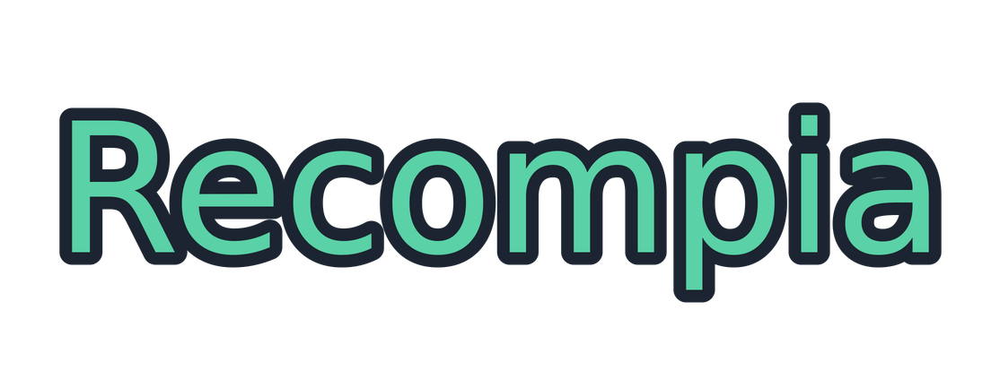

<!-- source-sha256: fe9c4332a6ff9d29519ac268a798a710b7f1ca3de409007d25acc713e80e83ee -->
> Ini adalah terjemahan bahasa Indonesia dari [README bahasa Inggris](../../README.md). Jika ada perbedaan, README bahasa Inggris adalah rujukan resmi.

<h1 align="center">
  
</h1>

<p align="center">
  <b>Game simulasi kehidupan yang santai dan sandbox builder dengan makhluk-makhluk fantastis (Switch 2, title ID 0400A3A01EE4C000, versi 2.0.1a), dikompilasi ulang agar berjalan secara native di Windows, Linux, Mac & Android dengan dukungan multipemain.</b>
</p>

<p align="center">
  <a href="https://github.com/Dittobyte/Recompia/releases/latest"></a>
  <a href="https://github.com/Dittobyte/Recompia/releases/latest"></a>
  <a href="https://github.com/Dittobyte/Recompia/releases">
  
  </a>
  <a href="https://github.com/Dittobyte/Recompia/releases"></a>
  
  
  
  <a href="https://github.com/Dittobyte/Recompia/commits/main"></a>
  <a href="https://github.com/Dittobyte/Recompia/issues"></a>
</p>

<p align="center">
  <a href="https://github.com/Dittobyte/Recompia/releases/latest"></a>
  <a href="https://github.com/Dittobyte/Recompia/releases/latest"></a>
  <a href="https://github.com/Dittobyte/Recompia/releases/latest"></a>
</p>

<p align="center">
  <b><a href="https://github.com/Dittobyte/Recompia/releases">Rilis</a></b> ·
  <a href="../../CHANGELOG.md">Catatan perubahan</a> ·
  <a href="../../CONTRIBUTING.md">Berkontribusi</a> ·
  <a href="../../CREDITS.md">Kredit</a> ·
  <a href="https://github.com/xFractals/pokopia-native">Proyek induk</a> ·
  <a href="../../SECURITY.md">Keamanan</a> ·
  <a href="../../LEGAL.md">Legal</a> ·
  <a href="../../PRIVACY.md">Privasi</a> ·
  <a href="https://github.com/Dittobyte/Recompia/issues">Issue</a> ·
  <a href="https://discord.gg/VyRcUUQNKH">Discord</a>
</p>

> [!IMPORTANT]
> **Tidak ada file game yang disertakan.** Anda memerlukan salinan hasil ekstraksi milik Anda sendiri dari game simulasi kehidupan yang santai dan sandbox builder dengan makhluk-makhluk fantastis ini (title ID 0400A3A01EE4C000, versi **2.0.1a**). Proyek ini tidak menyediakan file game, key, maupun alat dump. Lihat [LEGAL.md](../../LEGAL.md).

## Fitur

### Bermain bersama (Link Play)
- **Kunjungi pulau teman, atau undang mereka ke pulau Anda**, melalui jaringan Wi-Fi yang sama maupun lewat internet.
- **Cross-play dengan pemain dari [proyek induk](https://github.com/xFractals/pokopia-native)**.
- Atur di halaman **Link Play** pada launcher. Tidak perlu mengedit file apa pun.
- Panduan langkah demi langkah: [Bermain bersama](#bermain-bersama).

### Impor save Anda
- **Sudah bermain di Eden atau Ryujinx?** Satu tombol di **Settings** akan menemukan save Anda dan membawanya ke sini. Salinan di emulator Anda tidak tersentuh.
- **Punya save di tempat lain?** Pilih foldernya (folder yang berisi `B00`, `G00`, dan `S00` di dalamnya).
- **Save Anda saat ini tidak pernah dihapus.** Save tersebut disimpan terlebih dahulu sebagai folder cadangan.
- Jika save gagal ditulis (disk penuh, OneDrive atau antivirus menahan file), save terakhir yang baik tetap dipertahankan dan game akan memberi tahu Anda.

### Penyiapan mudah
- **Gunakan dump Anda apa adanya:** berupa folder (berisi `base` dan `updates`) atau satu file `.nup` maupun `.nx`.
- **Pesan jelas jika ada masalah pada dump Anda:** versi game salah, pembaruan tidak ada, atau file rusak saat disalin. Launcher memberi tahu apa yang harus dilakukan.
- **Pemeriksaan sebelum mulai:** ruang disk cukup, driver grafis berfungsi, memori mencukupi.
- **Use fewer cores** menjaga PC tetap nyaman dipakai selama proses build. Anda bisa menjeda lalu melanjutkannya nanti.
- **Pembaruan berlangsung cepat:** hanya bagian yang berubah yang dibangun ulang.
- Launcher memberi tahu saat versi baru sudah tersedia.

### Kontrol
- **Semua kontroler didukung:** Xbox, PlayStation, Switch Pro, dan lainnya, lengkap dengan getar dan sensor gerak. Secara default tombol mengikuti tata letak Switch.
- **Keyboard dan mouse.** Mouse juga berfungsi di menu: klik untuk mengonfirmasi item yang disorot; gulir atau gunakan tombol panah untuk memindahkan sorotan.
- **Ubah tombol apa saja** di halaman **Controls** lewat tombol F1.
- **Ikon tombol di layar menyesuaikan perangkat yang Anda pegang:** keyboard, Xbox, PlayStation, Steam Controller, atau Switch.
- **Mengetik nama Anda** berfungsi menggunakan kontroler, mouse, atau keyboard.
- **Keluar tanpa Alt+F4:** tahan Select dan Start (View dan Menu pada kontroler Xbox), atau gunakan **Quit game** di menu F1.
- **Buka menu F1 dari kontroler:** tekan kedua analog (L3 + R3); ubah atau matikan dengan `[overlay] pad` di `controls.ini` (`none` = mati). Kombinasinya tidak boleh sama dengan kombinasi keluar.

### Steam Deck dan perangkat genggam
- Steam Deck, Legion Go S, dan perangkat genggam lainnya dikenali otomatis: ikon kontroler tetap tampil di layar dan ukuran gambar menyesuaikan layar.
- Layar 16:10 terisi penuh dari ujung ke ujung tanpa bilah hitam.
- Berjalan secara native di SteamOS dengan optimasi perangkat genggam (sekitar 26 hingga 53 fps di Steam Deck dan 55 hingga 75 fps di Legion Go S, berdasarkan pengukuran pemain).
- Launcher juga berjalan di Linux dan SteamOS: lihat [Linux, SteamOS, dan Steam Deck](#linux-steamos-dan-steam-deck).

### Ponsel dan tablet Android
- **Satu APK untuk ponsel dan tablet arm64** (Android 11 atau lebih baru, Vulkan 1.3). APK ini tidak berisi file game: game dibangun di ponsel langsung dari dump Anda sendiri tanpa perlu PC.
- **Kontrol sentuh atau kontroler.** Kontrol sentuh otomatis tersembunyi saat kontroler USB atau Bluetooth tersambung. Seret pada bagian layar yang kosong untuk memutar kamera.
- **Default ponsel dipilih otomatis untuk Anda:** resolusi, batas frame rate, dan pengaturan memori disesuaikan dengan GPU dan RAM ponsel pada pemulaian pertama. Anda dapat mengubahnya di **Settings** aplikasi.
- **Co-op dan Link Play** juga berfungsi di ponsel: lihat [Bermain bersama](#bermain-bersama).
- Penyiapan dan cara bermain: lihat [Android](#android).

### Grafis
- **Bermain di resolusi apa saja**, 4K ke atas. Turunkan **Render scale** jika terasa lambat.
- **Preset kualitas** (Switch 2, High, Ultra) mengatur jarak pandang dan ketajaman tekstur.
- **HDR** di layar yang mendukung HDR.
- **Window, borderless, atau full screen.** Pilih monitor, batasi frame rate, tampilkan penghitung FPS. Alt+Enter mengganti mode layar saat bermain.
- **Upscaler:** FSR 1 dan NVIDIA Image Scaling berfungsi dengan baik.
- **FSR 3 dan DLSS / DLAA sudah ada tetapi hasilnya belum bagus** dan masih perlu perbaikan ulang. Untuk sementara biarkan mati.

### Pengaturan di dalam game
Tekan **F1** di dalam game untuk mengubah grafis, kontrol, dan suara (volume, perangkat output, bisukan saat jendela tidak aktif). Sebagian besar perubahan langsung berlaku.

Di Android, buka menu jeda game lalu **Settings**: opsi tampilan ponsel ada pada tab **Display** dan **Performance** (lihat [Pengaturan Android](#pengaturan-android)).

## Mulai cepat

1. Unduh `Recompia-<version>-windows-x64.zip` dari [rilis terbaru](https://github.com/Dittobyte/Recompia/releases/latest) dan ekstrak ke mana saja.
2. Jalankan `Recompia.exe`. Jika SmartScreen menampilkan peringatan, pilih **More info → Run anyway**. Pilih folder dump Anda lalu tekan **Set up**: ini akan mengompilasi game di PC Anda (sekitar 7 menit), lalu membangun cache shader (1 sampai 2 jam, dapat dijeda dan dilanjutkan nanti).
3. Tekan **Play**.

F1 membuka pengaturan di dalam game. Klik tengah mouse mengaktifkan/mematikan mode mouse Joy-Con 2 (arahkan dan klik untuk meletakkan serta menghancurkan blok).

### Linux, SteamOS, dan Steam Deck

1. Unduh `Recompia-<version>-linux-x86_64.tar.gz` dari [rilis terbaru](https://github.com/Dittobyte/Recompia/releases/latest) dan ekstrak ke mana saja (misalnya folder home Anda).
2. Jalankan `Recompia.AppImage` di folder tersebut (klik dua kali, atau `./Recompia.AppImage` di terminal). Pilih folder dump Anda lalu tekan **Set up**: pada kali pertama, aplikasi mengunduh alat build (Python dan Zig, sekitar 100 MB), mengompilasi game, lalu membangun cache shader. Anda bisa menjeda dan melanjutkannya nanti.
3. Tekan **Play**.

Tidak ada yang dijalankan lewat Proton atau Wine: launcher, game, penerjemah shader, dan alat build semuanya adalah program Linux native.

Jika `Recompia.AppImage` tidak bisa berjalan di sistem tanpa FUSE, jalankan `./Recompia.AppImage --appimage-extract-and-run`.

Untuk menjalankan dari Steam (Game Mode di Deck): tambahkan launcher ke Steam melalui Settings launcher (Steam, Add to Steam) atau di Desktop Mode lewat **Add a Non-Steam Game**, pilih `Recompia.AppImage` dan biarkan launch options kosong. Pintasan ini membuka launcher yang akan memeriksa pembaruan, lalu tekan Play. Detail selengkapnya dan perangkat yang sudah diuji ada di [launcher/README.md](../../launcher/README.md#linux-steamos-the-steam-deck-bazzite-other-distributions).

### Android

**Yang Anda perlukan:**
- Ponsel atau tablet arm64 dengan Android 11 atau lebih baru dan Vulkan 1.3. Sudah diuji pada Snapdragon 8 Gen 3 (Adreno 750). Driver Mesa Turnip bawaan mendukung GPU Adreno 6xx, 7xx, dan 8xx (Snapdragon 8 Gen 1 hingga 8 Gen 3 dan 8 Elite). Disarankan RAM 12 GB; ponsel dengan RAM lebih kecil memakai [profil memori rendah](#masalah-umum). Ponsel dengan GPU lain (Exynos, Mali, dan lainnya) memakai driver bawaan ponsel serta setelan konservatif, dan jauh lebih sedikit diuji.
- Dump game milik Anda sendiri yang sudah didekripsi dalam bentuk folder: folder yang sama dengan yang dipakai launcher PC (`base` dan `updates`, atau `exefs` dan `romfs`). Sekitar 7,3 GB. Aplikasi tidak pernah mengunduh data game dan tidak menyertakan file game.
- Ruang kosong: sekitar 7,3 GB untuk file game, 2,6 GB saat game dibangun (0,6 GB tersimpan permanen), dan 6,6 GB untuk shader. Menerjemahkan shader di ponsel membutuhkan ruang kosong 12 GB saat dimulai.

**Penyiapan:**
1. Unduh `Recompia-<version>-android-arm64.apk` dari [rilis terbaru](https://github.com/Dittobyte/Recompia/releases/latest) dan buka di ponsel. Izinkan browser atau manajer file memasang aplikasi jika Android meminta izin.
2. Salin dump ke ponsel: hubungkan ponsel ke PC dengan kabel USB, pilih **File transfer** di ponsel, lalu salin seluruh folder ke folder `Download` ponsel. Kartu microSD atau USB drive juga bisa dipakai. Salin dalam mode biner: penyalinan FTP mode teks merusak file.
3. Buka Recompia dan tekan **Get started**. Pada **Storage access**, tekan **Allow storage access** dan izinkan akses ke semua file: aplikasi membaca dump Anda langsung di tempatnya dan menyimpan datanya sendiri di `/sdcard/Recompia`.
4. Pada **Game files**, dump yang berada di `Download` atau di tingkat teratas penyimpanan ponsel akan tampil di bawah **Found on this phone**. Jika tidak muncul, tekan **Choose a folder** dan pilih foldernya. File diperiksa dan dibaca di tempat tanpa disalin. (Folder yang tidak bisa dibaca langsung oleh aplikasi akan ditawarkan untuk disalin ke `/sdcard/Recompia/dump`.)
5. Pada **Build**, tekan **Start building**. Game dibangun di ponsel dari file Anda: sekitar 45 menit di ponsel Snapdragon 8 Gen 3 sambil mengisi daya, lebih lama pada ponsel yang lebih lambat atau panas. Biarkan ponsel terhubung ke pengisi daya dan berada di tempat sejuk. Proses build tetap berjalan saat aplikasi ditutup, dan **Pause** menyimpan pekerjaan yang sudah selesai.
6. Pada ponsel dengan GPU Adreno, langkah **Graphics driver** muncul berikutnya: tekan **Use the included Turnip driver**. Driver bawaan ponsel menampilkan gambar hitam pada game ini.
7. Pada **Shaders**, tekan **Translate on this phone** (sekitar 1,5 hingga 2 jam di ponsel yang sama; proses ini bisa dijeda). Atau, jika Anda sudah punya Recompia di PC, salin folder `shader_cache` dari PC (tanpa folder `corpus`) ke `/sdcard/Recompia/shader_cache` lalu tekan **Import a shader cache from a PC install** untuk melewati proses terjemahan yang lama.
8. Tekan **Play**.

**How to get your game files onto the phone** di layar Home aplikasi berisi langkah yang sama.

#### Kontrol sentuh dan kontroler

- **Kontrol sentuh** tampil saat tidak ada kontroler yang tersambung. Tombol menu di layar membuka menu sentuh: **Hide touch controls**, **Edit layout** (seret tombol untuk memindahkan; ketuk satu tombol, lalu **Smaller** atau **Bigger**), **Exit to Recompia**, dan **Back to the game**.
- Seret area kosong di layar untuk memutar kamera; ketukan singkat di sana diteruskan ke game. Sensitivitas dan pembalikan sumbu ada di **Settings** aplikasi pada **Touch camera**.
- **Kontroler** melalui USB atau Bluetooth didukung. Kontrol sentuh otomatis tersembunyi saat kontroler tersambung (**Hide when a controller is connected** di **Settings**).
- Opasitas, ukuran, getaran, dan **Reset touch layout** ada di **Settings** aplikasi pada **Touch controls**.

#### Pengaturan Android

**Settings** di aplikasi berisi pengaturan tampilan, kontrol sentuh, gameplay, Link Play, dan driver GPU; sebagian besar berlaku saat game dijalankan berikutnya. Di dalam game, **Settings** di menu jeda memiliki opsi berikut di tab **Display**:

| Pengaturan | Fungsinya |
|---|---|
| **Frame Rate Limit** | Setiap pilihan adalah kelipatan bulat dari refresh layar. Default 30; angka lebih rendah berjalan lebih sejuk dan stabil. |
| **Resolution** | Resolusi gambar 3D, dari 15% hingga 100% ukuran layar per sisi. Menu dan teks tetap tajam. Langsung berlaku: turunkan jika ponsel panas atau melambat. Pemulaian pertama memilih porsi layar yang sesuai dengan GPU ponsel. |
| **Dynamic Resolution** | Mati secara default. Menurunkan resolusi di bawah nilai di atas saat GPU tertinggal, dan menaikkannya kembali. **Dynamic Resolution Mode** memilih **GPU Time** atau **Heat** (juga menahannya agar ponsel tidak terkena throttling). |

Dan di tab **Performance**:

| Pengaturan | Fungsinya |
|---|---|
| **Upscaler** | **SGSR** (Snapdragon Game Super Resolution, pilihan default dan yang disarankan: lebih ringan dan stabil) mempertajam gambar 3D yang diperbesar. **SGSR 2** membangun detail lebih tinggi dari beberapa frame, tetapi bebannya lebih berat dan bisa sedikit berkilau saat bergerak; opsi ini tidak tersedia di ponsel berprofil memori rendah. **Off** merentangkan gambar apa adanya. Menu tetap tajam di semua mode. Berlaku setelah pengaturan disimpan. |
| **Sharpness** | Seberapa tajam **SGSR 2** mempertajam gambarnya (**SGSR** tidak memakainya). Langsung berlaku. |

## Mod dan terjemahan

Anda dapat menumpuk folder berisi file pengganti (mod teks atau tekstur, atau terjemahan) di atas game tanpa menyentuh dump game: **Settings > Game > Mods**, atau `romfs_mod` di bawah `[fs]` pada `pkp.ini`. Tidak ada mod yang dibundel bersama proyek ini; dapatkan mod dari pembuatnya.

Folder yang Anda pilih harus memiliki struktur yang sama seperti folder `romfs` bawaan game: file dan folder yang sama dimulai dari tingkat teratas. File di dalamnya menggantikan file game dengan jalur yang sama, folder digabungkan, dan file yang hanya ada di mod juga ikut disajikan.

```text
MyMod/                       <- choose this folder in Settings > Game > Mods
├── LD_C0_R.BIN              <- same path as in the game's romfs
├── LI_C0_R.IDX
└── motor_asset_re/
    └── ...
```

Jika file unduhan memiliki folder pembungkus luar (misalnya `2.0.1/romfs/...`), pilih folder `romfs` di bagian dalam, yaitu folder yang berisi `LD_C0_R.BIN`, bukan folder luarnya. Jika tingkat foldernya salah, `pkp.log` akan mencatat bahwa tidak ada file mod yang menggantikan file game. Mod yang mengganti file berisi shader tidak didukung.

### Mod dan terjemahan (Portugis Brasil)

Anda dapat menempatkan folder berisi file pengganti (mod teks atau tekstur, atau terjemahan) di atas game tanpa menyentuh dump: **Settings > Game > Mods**, atau `romfs_mod` di bawah `[fs]` pada `pkp.ini`. Proyek ini tidak menyertakan mod apa pun; mintalah dari pembuat mod.

Folder yang dipilih harus memiliki struktur yang sama dengan folder `romfs` game: file dan folder yang sama dimulai dari tingkat teratas. Filenya menggantikan file game pada jalur yang sama, folder digabungkan, dan file yang hanya ada di mod juga digunakan.

Jika unduhan memiliki folder luar (misalnya `2.0.1/romfs/...`), pilih folder `romfs` di dalam, yaitu folder yang berisi `LD_C0_R.BIN`, bukan folder luarnya. Jika tingkat foldernya salah, `pkp.log` memberi tahu bahwa tidak ada file mod yang menggantikan file game. Mod yang mengganti file berisi shader tidak didukung.

## Memperbarui dari versi lama

Save, pengaturan, dan shader Anda tetap terjaga.

**Dari 0.7.5 ke atas:** tekan **Update** di Home (atau di Settings > About). Launcher mengunduh rilis baru, memeriksanya, mengganti filenya sendiri, lalu memulai ulang. Jika rilis mengubah kode game, launcher terlebih dahulu membangun program game baru (`pkp.exe`) di sebelah yang sudah ada menggunakan alat rilis baru. Proses ini memakan waktu dari beberapa menit hingga satu jam tergantung PC Anda, dan Anda tetap bisa bermain selama proses berlangsung: Home menampilkan progresnya, dan pembaruan dipasang begitu game ditutup. **Cancel** menghentikannya dan tidak mengubah apa pun; tombol **Update** berikutnya melanjutkan dari titik terakhir.

**Dari 0.7.0 atau lebih lama:** unduh zip baru (Windows) atau `Recompia-<version>-linux-x86_64.tar.gz` (Linux) dari [rilis terbaru](https://github.com/Dittobyte/Recompia/releases/latest), tutup game dan launcher, lalu ekstrak menimpa instalasi Anda ke folder yang sama. Paket ini tidak berisi save, pengaturan, cache shader, maupun file game, sehingga data Anda tidak tertimpa.

**Jika Home menampilkan Finish update setelah pembaruan:** rilis tersebut mengubah kode game dan belum sempat dibangun sebelum pembaruan (instalasi yang diekstrak manual, atau versi lama yang dipilih di Settings), sehingga launcher membangun ulang program game (`pkp.exe`) dari file game Anda. Hal ini juga terjadi jika Anda sempat melewati rilis semacam itu dan memperbarui secara manual belakangan. Prosesnya memakan waktu beberapa menit hingga satu jam tergantung PC Anda, sementara shader dan save Anda tetap aman. Ini bukan penyiapan awal yang lama: shader hanya diterjemahkan ulang jika catatan rilis menyatakannya, dan hanya shader yang berubah saja. `pkp.exe` yang lama tetap ada sampai yang baru siap.

Salin folder `save` ke tempat lain terlebih dahulu jika Anda ingin cadangan. Save yang ditulis oleh versi lebih baru mungkin tidak bisa dimuat di versi lama.

**Android:** unduh `Recompia-<version>-android-arm64.apk` baru dari [rilis terbaru](https://github.com/Dittobyte/Recompia/releases/latest) lalu pasang menimpa aplikasi yang sudah ada. Save, pengaturan, cache shader, dan file game Anda di `/sdcard/Recompia` tetap ada. Jika Home kemudian menampilkan **Set up again**, tekan tombol itu: versi baru membawa alat build baru atau antarmuka game baru, sehingga game dibangun ulang di ponsel. Save dan shader tetap aman.

**Android, dari 0.16 ke 0.17.0:** APK 0.17.0 memiliki nomor versi Android yang lebih rendah daripada APK 0.16, sehingga Android menolak memasangnya menimpa 0.16. Sebelum rilis dengan perbaikannya ([#898](https://github.com/Dittobyte/Recompia/pull/898)) keluar, copot pemasangan 0.16 dulu lalu pasang 0.17.0. Pencopotan tetap mempertahankan semua isi `/sdcard/Recompia` (save, cache shader, `pkp.ini`, dan `controls.ini`), tetapi menghapus data di dalam aplikasi: game hasil build, driver GPU, serta pengaturan dan tata letak kontrol sentuh. Penyiapan lalu berjalan ulang: izinkan akses penyimpanan, pilih file game, bangun ulang game, dan pada ponsel Adreno pilih lagi driver Turnip. Cache shader akan ditemukan di tempatnya semula.

## Bermain bersama

Link Play menempatkan beberapa pemain di satu pulau. Cross-play berfungsi dengan pemain proyek induk pada versi game **2.0.1**. Pemain dengan game versi 1.0.5 tidak dapat bergabung.

**Yang berubah.** Link Play kini memakai protokol co-op proyek induk. Protokol ini tidak kompatibel dengan build Link Play lama dari port ini, jadi semua pemain harus memperbarui ke rilis ini.

**Setiap pemain membutuhkan save masing-masing.** Salinan save milik orang lain tidak dapat bergabung ke save aslinya.

**Penyiapan.** Di launcher, buka **Link Play** lalu pilih salah satu:

| Pilihan | Kegunaan |
|---|---|
| Off | Tanpa Link Play. |
| Same network | Pilihan default. Wi-Fi atau jaringan yang sama: host ditemukan otomatis. Jika tidak, ketik alamat host, misalnya `192.0.2.10` (tertera di bawah **This PC** pada halaman host), di kolom **Join directly**. |
| Internet | Bermain lewat internet. Setiap ruang muncul di daftar **Visit a Friend** dalam game: tanpa kode ruang, tanpa port forwarding. |

Perubahan berlaku saat game dijalankan berikutnya.

**Di dalam game**, buka PC di rumah pertama Anda, lalu pilih **Link Play** (terbuka setelah Environment Level 2 di Withered Wasteland) dan pilih **Local connection**. (**Online connection** adalah layanan resmi Nintendo dan tidak berfungsi di sini.) Host memilih **Invite Others to Visit**, sedangkan pemain lain memilih **Visit a Friend**.

**Jaringan yang sama.** Semua pemain memilih **Same network**. Steam Deck dan perangkat Proton atau Linux lainnya dapat menemukan host dan ditemukan juga pada jaringan apa pun. Wi-Fi kafe, hotel, dan tamu sering memisahkan antarperangkat: dalam kondisi itu, bermainlah lewat internet.

**Lewat internet.** Semua pemain memilih **Internet**. Tidak perlu meneruskan port maupun mengetik kode: launcher memakai relay publik proyek, dan setiap ruang di dalamnya muncul di daftar **Visit a Friend** dalam game. Untuk ruang pribadi, jawab ya saat game meminta mengatur **Link Code**: hanya pemain yang mengetikkan kode tersebut yang dapat bergabung. Relay Anda sendiri atau port yang diteruskan ada di bawah **Advanced**; relay co-op mana pun dari proyek induk bisa dipakai di sana, dan `Recompia --host` menjalankan relay di server. **[Panduan Link Play](../link-play.md)** berisi langkah-langkah serta hal yang perlu diperiksa saat gagal terhubung; [halaman multipemain lengkap](../multiplayer/README.md) membahas relay dan port. Relay tidak mengenkripsi lalu lintas game.

**Port dan firewall.** Saat pertama kali menjadi host, Windows Firewall menanyakan `pkp.exe`: izinkan pada **Private networks**. Jaringan Anda juga harus berstatus Private (Settings, Network & internet, koneksi Anda, Network profile type: **Private**).

| Port | Pemakai | Protokol |
|---|---|---|
| 47600 | host | TCP dan UDP |
| 47610 | relay | TCP, dan UDP untuk jalur lebih cepat |

**Interact everywhere (eksperimental, mati secara default).** Di area cerita, game menempatkan pengunjung ke Spectator Mode. **Interact everywhere** memungkinkan mereka memakai jurus dan item, mengambil, meletakkan, serta membangun di sana. Semua pemain harus memakai sakelar yang sama, atau host tidak akan muncul di daftar.

Link Play: bergabung dan berjalan bersama sudah berfungsi. Lihat [docs/multiplayer](../multiplayer/README.md) untuk cara kerjanya dan kunci `pkp.ini`.

**Di Android.** Link Play ada di **Settings**, **Link Play** aplikasi: **Same network** atau **Internet**, sama seperti di atas. Ponsel tidak mencari host di jaringan secara otomatis: untuk berkunjung di jaringan yang sama, ketik alamat host; untuk menjadi host, biarkan kosong. Lewat internet, ruang di relay tampil di **Visit a Friend**. Perubahan berlaku saat game dijalankan berikutnya. Co-op adalah kartu **Recompia: Co-op** di Home: bergabunglah dengan undangan yang dibagikan pembuat save co-op (kode pendek `XXX-XXX` yang berlaku 6 jam, atau teks panjang `PKCOOP1.`), atau buat save co-op baru di sana dan undang pemain lain. Semua pemain bermain melalui relay save tersebut, dan save co-op baru dimulai dari awal permainan.

## Masalah umum

- **Jendela berwarna hitam, atau game sangat patah-patah, saat pertama kali dijalankan.** Game membuat sebagian shader sambil berjalan. Launcher menerjemahkan shader yang sudah pernah terlihat sebelum setiap kali mulai dan setelah Anda keluar, sehingga awal permainan memang berat lalu membaik pada sesi berikutnya. Tunggu sebentar dan teruslah bermain. Jika penyiapan sempat berhenti di tengah jalan, buka **Game files** dan tekan **Set up** untuk melanjutkan. Pekerjaan yang sudah selesai tetap disimpan.
- **Windows menampilkan "Smart App Control blocked" untuk launcher, penyiapan, atau game.** Smart App Control hanya menjalankan program yang ditandatangani secara digital atau sudah dikenal Microsoft, dan tidak memiliki tombol **Run anyway**. Game (`pkp.exe`) dikompilasi di PC Anda sendiri saat penyiapan, sehingga tidak pernah memiliki tanda tangan digital. Matikan Smart App Control: **Windows Security**, **App & browser control**, **Smart App Control settings**, **Off**. Pada beberapa versi Windows 11 opsi ini tidak bisa dinyalakan lagi tanpa mereset Windows, jadi baca pesan Windows dengan saksama sebelum konfirmasi. Setelah itu jalankan ulang `Recompia.exe` dan tekan **Set up** jika sebelumnya terhenti.
- **Launcher menyatakan file game dari versi lama, atau pembaruan tidak ada.** Rilis ini membutuhkan versi 2.0.1a. Dump ulang game Anda bersama pembaruan yang terpasang. Game dasar saja tidak cukup.
- **Launcher menyatakan tidak menemukan file game yang dapat digunakan, atau Set up menyatakan file tidak cocok.** Pilih folder yang berisi `base` dan `updates` (misalnya `Game_v2.0.1a`). Masing-masing membutuhkan `exefs` (`main`, `sdk`, `subsdk0`, `rtld`, `main.npdm`) dan `romfs`. File yang tidak cocok berarti rusak. Dump ulang atau salin ulang file tersebut.
- **Launcher menyatakan data game (romfs) tidak lengkap, atau game langsung tertutup saat mulai dengan "pkp.exe exited with code 4".** Alat dump Anda menulis `romfs` pembaruan tanpa menyertakan file game dasar di bawahnya (pembaruan hanya berisi file yang berubah). Simpan game dasar di dump yang sama (`base` di sebelah `updates`, masing-masing dengan `exefs` dan `romfs`) dan pilih folder yang berisi keduanya: launcher akan melengkapi file yang kurang dari `base` secara otomatis. Lalu tekan **Set up** sekali lagi. Alternatifnya, dump ulang game dengan pembaruan sudah digabung ke game dasar.
- **Launcher menyatakan file game disalin dalam mode teks.** Penyalinan FTP dalam mode teks merusak file biner di `exefs` seperti `main` atau `subsdk0`. Salin ulang folder `exefs` dan `romfs` dengan jenis transfer diatur ke **Binary** (FileZilla: Transfer, Transfer type, Binary).
- **Dump Anda berupa satu file** (`.nsp`, `.xci`). Launcher menerima game dalam bentuk folder, atau paket `.nup` maupun `.nx` (file `.nx` yang dibuat dari file hasil ekstrak atau dari `.nup`, bukan langsung dari `.nsp` atau `.xci`). Ekstrak `.nsp` atau `.xci` menjadi folder dengan alat dump Anda.
- **Penyiapan berhenti dengan error tentang file yang tidak bisa dibuka atau dihapus.** Letakkan folder di lokasi sederhana seperti `C:\Recompia`, bukan di folder yang disinkronkan OneDrive. Antivirus Anda mungkin sedang memindai file yang sedang dibangun: tunggu sebentar atau beri pengecualian untuk folder tersebut. **Open setup log** menunjukkan titik berhentinya.
- **Set up memberi peringatan sebelum mulai.** Pemeriksaan awal mengecek ruang disk kosong (sekitar 14 GB dengan file shader terkemas yang menjadi default, atau sekitar 31 GB dengan file lepas), Vulkan, memori, dan prosesor. Pada CPU desktop Intel generasi ke-13 atau ke-14, perbarui BIOS sebelum menyiapkan: tanpa perbaikan dari Intel, CPU ini bisa crash saat beban penuh berkepanjangan. Jika PC terasa panas atau berat saat proses build, centang **Use fewer cores**.
- **Frame rate rendah, atau gambar buram.** Ukuran gambar dikunci saat game mulai berdasarkan ukuran jendela atau layar pada saat itu (**Settings**, **Display**).
  - Memulai dalam mode **Borderless** di layar 4K membuat game menggambar di 4K. Itu berat. Turunkan **Render scale**.
  - Memulai dalam mode **Windowed** (default 1280x720) lalu menekan Alt+Enter membuat gambar tetap 720p yang diperbesar. Atur **Window mode** sebelum menekan **Play**.
  - Atur **Frame rate limit** sesuai kemampuan layar Anda.
- **Link Play: pengunjung tidak dapat menemukan host.** Pilih **Visit by address** dan ketik alamat host (halaman Link Play host menampilkannya). Pastikan host sudah menjalankan game dan memilih **Invite Others to Visit**, Windows Firewall mengizinkan `pkp.exe` di jaringan Private, dan jaringan berstatus Private. Wi-Fi kafe, hotel, dan tamu yang mengisolasi perangkat memblokir permainan LAN untuk semua orang: gunakan **Internet** dengan relay dan kode ruang. Untuk permainan lewat internet, periksa alamat relay dan kode ruangnya. Perubahan di halaman Link Play berlaku saat game dijalankan berikutnya.
- **Link Play: koneksi ditolak.** Pemain tidak cocok. Semua pemain harus memakai game 2.0.1, rilis yang sama (atau proyek induk untuk cross-play), mod yang sama, dan sakelar **Interact everywhere** yang sama.
- **Link Play: "Communication error" (9005) saat berkunjung.** Kalian berdua memainkan salinan dari save yang sama sehingga memiliki ID pemain yang sama. Setiap pemain membutuhkan save sendiri.
- **Kontroler tidak terdeteksi.** Buka menu game dengan F1 dan lihat baris **Gamepad** di halaman Controls. Baris itu bertuliskan "No gamepad open" jika game tidak melihat kontroler. Hubungkan kontroler sebelum menekan **Play**, lalu coba kabel atau port lain. Tutup program lain yang mungkin menahan kontroler tersebut.

**Di Android:**
- **Gambar hitam pada ponsel dengan GPU Adreno.** Driver bawaan ponsel menampilkan gambar hitam pada game ini. Di **Settings**, **GPU driver** aplikasi, pilih **Use the included Turnip driver**. Jika game tidak mau berjalan atau tampilannya rusak dengan driver tersebut, pilih **Use the system driver** di sana.
- **RAM ponsel kurang dari 12 GB** (misalnya ponsel 8 GB). Aplikasi memakai profil memori rendah: ukuran bayangan dan tekstur lebih kecil, resolusi output lebih rendah, serta sekitar 5 GB ruang penyimpanan kosong dipakai sebagai memori tambahan untuk game. Jika ruang kosong kurang dari itu, game berjalan tanpanya dan bisa kurang stabil: Home akan memberi tahu. Kosongkan ruang penyimpanan untuk hasil terbaik.
- **Ponsel menjadi panas, atau frame rate turun setelah beberapa lama.** Ponsel menurunkan kecepatan saat panas. Turunkan **Resolution** di **Settings**, **Display** game (langsung berlaku), atau turunkan **Frame Rate Limit**. Atur **Counter Detail** penghitung frame rate ke **Full** untuk melihat suhu ponsel serta beban GPU dan CPU. Proses build dan penerjemahan shader adalah tugas panjang yang berat: biarkan ponsel terpasang ke pengisi daya di tempat yang sejuk, dan aplikasi akan memberi peringatan saat ponsel mulai hangat.
- **Proses build berhenti saat aplikasi ditutup oleh sistem.** Buka aplikasi lalu tekan **Continue building**: pekerjaan yang sudah selesai tetap disimpan.
- **File game tidak bisa dipakai.** Langkah **Game files** memberi tahu apa masalahnya (versi lebih lama, game dasar tanpa pembaruan, file hilang atau rusak saat disalin) dan cara memperbaikinya, sama seperti di PC. Masing-masing `base` atau `updates/<version>` membutuhkan `exefs` dan `romfs`. **Show details** mencantumkan apa yang kurang.

Jika bukan salah satu dari masalah di atas, lihat [Melaporkan masalah](#melaporkan-masalah).

## Lokasi save, log, dan pengaturan Anda

Semuanya berada di folder game: folder tempat `Recompia.exe` dan `pkp.exe` berada, kecuali Anda memilih lokasi lain di **Settings**, **Game folder**.

| Isi | Lokasi |
|---|---|
| Save | `save` (**Settings** bisa mengarahkannya ke tempat lain: **Save folder**) |
| Pengaturan | `pkp.ini` dan `controls.ini` (F1 di game menulis `controls.ini`) |
| Log | `pkp.log`, ditulis setiap kali dijalankan dari launcher. Jika crash, tertulis juga `pkp_crash.txt`, `pkp_freeze.txt`, atau `pkp_fatal.txt`. |
| Shader terjemahan | `shader_cache` (sekitar 26 GB) |
| File build | `build` (folder kerja penyiapan) |
| `.nup` atau `.nx` terbongkar | `nup_dump`, jika Anda memilih `.nup` atau `.nx` (konten tambahannya, jika ada, di `nup_dump/aoc`) |
| Pengaturan launcher | `%APPDATA%\org.pkp-recomp.launcher\launcher.json` (folder dump dan folder game Anda) |

**Di Android** semuanya berada di `/sdcard/Recompia` (penyimpanan internal ponsel, folder `Recompia`):

| Isi | Lokasi |
|---|---|
| Save | `save` (save co-op di `coop-saves`). **Saves** di Home mengekspornya sebagai zip untuk PC, atau mengimpor zip folder save dari PC. |
| Pengaturan | `pkp.ini` dan `controls.ini`. Pengaturan dan tata letak kontrol sentuh disimpan di dalam aplikasi. |
| Log | `logs/pkp.log`. **Logs** di Home menampilkan log terbaru dan bisa membagikannya atau menyimpan salinan. |
| Shader terjemahan | `shader_cache` (sekitar 6,6 GB) |
| File build | `build` (folder kerja proses build) |
| Salinan file game | `dump`, hanya jika aplikasi menyalin dump Anda. Jika tidak, dump dibaca langsung di lokasi asalnya. |
| Game hasil build dan driver GPU | di dalam aplikasi, ikut terhapus saat aplikasi dicopot |

**Storage** di Home menampilkan ukuran masing-masing dan dapat menghapus file build, cache shader, salinan dump, atau save.

Jangan pernah melampirkan file game, folder `build` atau `shader_cache`, maupun save ke sebuah issue. `pkp.log` sudah cukup.

## Komunitas

Pertanyaan, bantuan bug, pengujian, dan obrolan: bergabunglah di [Discord Recompia](https://discord.gg/VyRcUUQNKH). Launcher juga memiliki tombol **Join Discord** di bawah Settings > About > Community. Bug yang memerlukan perbaikan tetap dilaporkan di [GitHub](https://github.com/Dittobyte/Recompia/issues/new/choose).

## Melaporkan masalah

[Buka issue](https://github.com/Dittobyte/Recompia/issues/new/choose) disertai `pkp.log` dari sesi terjadinya masalah, jenis GPU, dan versi Windows Anda (di Linux: distribusi, versi Proton, dan perangkat; di Android: chipset, versi Android, dan driver GPU, beserta log yang dibagikan dari **Logs** di aplikasi).

**Linux, SteamOS, dan handheld Linux:** Saya (Jerban) menangani sisi Linux, sehingga bug Linux diperbaiki dan dikirim cepat lewat pembaru satu klik. Maaf atas pembaruan yang sering, dan terima kasih atas kesabarannya. Silakan terus laporkan bug Linux, selalu sertakan log Anda: `pkp.log`, serta `setup.log` untuk masalah pada Set up (lihat [Lokasi save, log, dan pengaturan Anda](#lokasi-save-log-dan-pengaturan-anda)). Hal di luar Linux ditinjau oleh Josh terlebih dahulu.

## Lisensi

GPL-3.0. Kode pihak ketiga tetap mengikuti lisensinya masing-masing, lihat [CREDITS.md](../../CREDITS.md).
